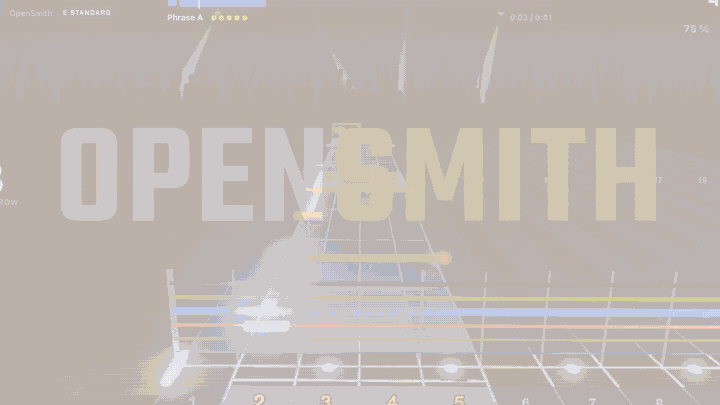

# OpenSmith

*English: [README.md](README.md)*



Un jeu de guitare pour macOS. Branche une vraie guitare électrique, glisse n'importe quel MP3 et
joue-le sur une piste de notes en 3D, avec détection des notes en temps réel, un simulateur
d'ampli et une carrière du garage au stade.

- **Tes propres morceaux** : un MP3 (ou WAV, FLAC, M4A…) est séparé en pistes (Demucs), la
  guitare transcrite (Basic Pitch) et placée sur le manche (un solveur de Viterbi), avec cinq
  niveaux de difficulté. Pose une tablature Guitar Pro à côté du MP3 et OpenSmith prend ses
  notes, calées sur l'enregistrement. Les morceaux écrits à la main au format
  [feedpak](https://github.com/got-feedBack/feedpak-spec) (le format ouvert de feedBack) se jouent
  tels quels, avec leur audio.
- **Ta vraie guitare** : détection des notes et des accords en Rust à 48 kHz avec des buffers
  de 64 échantillons, calibrage de la latence, un accordeur et un ampli avec les canaux clair,
  crunch, lead et métal.
- **Travailler** : Loop Trainer (un passage en boucle, ralenti sans changer la hauteur des
  notes, qui accélère quand tu le maîtrises), difficulté dynamique, maîtrise par phrase, mode
  Maître, Score Attack.
- **Carrière** : des concerts chaque semaine, une setlist, un public qui réagit à chaque note,
  un groupe, du matos, un label, des festivals et un groupe rival.
- **Un morceau de démo** est dans la bibliothèque dès le premier lancement, pour jouer tout de
  suite.

## Prérequis

- Un Mac Apple Silicon (M1 ou plus récent), macOS 13 Ventura ou plus récent.
- Une guitare électrique et un moyen de la brancher au Mac : le câble USB **Real Tone Cable**
  (détecté tout seul) ou n'importe quelle interface audio. Casque conseillé.
- Pour importer des morceaux : [uv](https://docs.astral.sh/uv/) et ffmpeg
  (`brew install uv ffmpeg`), et environ 2 Go de disque pour le convertisseur, qui s'installe
  au premier import.

## Installer

**Télécharger** : prends le `.dmg` sur la page [Releases](../../releases) et glisse OpenSmith
dans Applications. Les versions ne sont pas encore signées par Apple : la première fois, macOS
refuse d'ouvrir l'app. Ouvre **Réglages Système → Confidentialité et sécurité** et clique sur
**Ouvrir quand même** (sur macOS 13–14 : clic droit sur l'app → Ouvrir), ou lance :

```bash
xattr -dr com.apple.quarantine /Applications/OpenSmith.app
```

**Compiler depuis les sources** (Rust, Node 20+, uv) :

```bash
cd app && npm install && npm run tauri build
```

L'app arrive dans `app/src-tauri/target/release/bundle/`. Voir
[docs/macos-release.md](docs/macos-release.md) pour la signature et la notarisation.

## Premiers pas

1. Ouvre OpenSmith. Un court guide te fait brancher la guitare, régler le niveau d'entrée,
   calibrer la latence (gratter sur 12 clics) et t'accorder.
2. **Morceaux → First Riff** : le morceau de démo. Espace met en pause, `?` liste tous les
   raccourcis.
3. Importe ta propre musique : glisse des MP3, une tablature Guitar Pro, un feedpak ou tout un
   dossier sur la fenêtre. Compte une demi-minute par morceau sur un Mac M (le premier import
   installe aussi le convertisseur, quelques minutes).
4. Essaie la **Carrière**, le **Loop Trainer** sur un passage difficile, et **Réglages → Jeu →
   Langue** (anglais ou français).

Pas de guitare sous la main ? L'interrupteur **Démo auto** (en haut à droite) fait jouer le jeu
tout seul.

## FAQ

**Des morceaux sont-ils fournis ?** Seulement le morceau de démo, généré par du code. Tu
apportes ta musique : OpenSmith convertit les fichiers que tu as, sur ton Mac. Rien n'est
envoyé en ligne.

**Que valent les partitions faites depuis un MP3 ?** Bien pour les riffs et les parties
claires ; approximatives sur les guitares denses, saturées ou superposées, où l'IA rate
beaucoup de notes. Pour une partition exacte, pose la tablature Guitar Pro du morceau
(`.gp3`/`.gp4`/`.gp5`) à côté du MP3 avec un nom proche : OpenSmith prend ses notes et les cale
sur l'enregistrement.

**Faut-il le Real Tone Cable ?** Non. N'importe quelle interface audio marche ; choisis son
entrée dans **Réglages → Audio & guitare**. Le câble, lui, est simplement trouvé tout seul.

**D'autres formats de fichiers ?** Les morceaux feedpak (archives `.feedpak` ou dossiers)
s'importent tels quels : la partition telle que son auteur l'a écrite (avec ses niveaux de
difficulté s'il y en a) et l'audio du pack. Au-delà, le convertisseur accepte des plugins : un
paquet Python qui ajoute une commande d'import (voir [CONTRIBUTING.md](CONTRIBUTING.md)). Une
fois installé, l'app accepte ses fichiers comme des MP3.

**Windows, Linux, Mac Intel ?** Pas encore. Les portages Windows et Linux sont en cours ; le
plus dur est une latence jouable à la guitare. Sous Windows, le mode audio partagé ajoute 25 à
40 ms : le moteur doit passer par le mode exclusif WASAPI ou par ASIO. Sous Linux, il faut
PipeWire (ou JACK) et vérifier que la piste de notes 3D tient 60 images/s dans sa vue web. Si tu
connais ces API audio, ton aide est bienvenue : voir [CONTRIBUTING.md](CONTRIBUTING.md). Pas de
version pour Mac Intel aujourd'hui.

**Où sont mes morceaux ?** Dans `~/Music/OpenSmith`, un dossier par morceau (partition, piste
d'accompagnement, pochette).

## Pour les développeurs

[CONTRIBUTING.md](CONTRIBUTING.md) explique l'organisation, l'installation et les tests. Les
outils en ligne de commande (`opensmith-ingest` pour convertir des morceaux, `opensmith-diag`
pour tester le moteur audio) et toutes les fonctions de l'app sont décrits dans
[docs/guide.fr.md](docs/guide.fr.md) ; [PROGRESS.md](PROGRESS.md) est le journal de ce qui a
été construit et mesuré.

## Licence

OpenSmith est un logiciel libre sous [licence publique générale GNU v3.0 ou ultérieure](LICENSE) :
tu peux l'utiliser, l'étudier, le partager et le modifier ; les versions que tu distribues
restent sous la même licence, avec leur code source. Les composants tiers gardent leur licence
([THIRD_PARTY_NOTICES.md](THIRD_PARTY_NOTICES.md)).

## Marques

Rocksmith® est une marque d'Ubisoft Entertainment. OpenSmith est un projet indépendant, sans
lien avec Ubisoft, ni approuvé ni soutenu par Ubisoft. Il ne contient ni contenu, ni code, ni
clé de chiffrement du jeu ; Rocksmith n'est cité que pour désigner le matériel compatible (le
Real Tone Cable).
